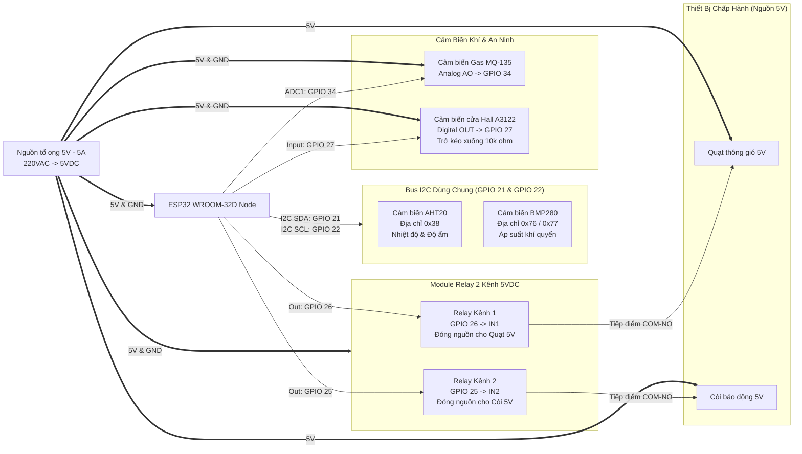
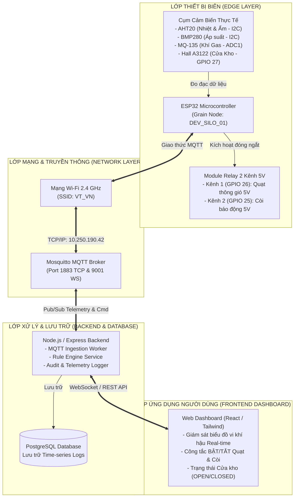
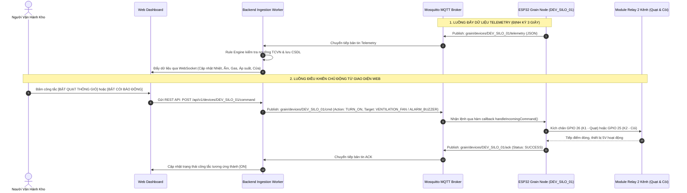

# 🌾 HỆ THỐNG GIÁM SÁT & ĐIỀU KHIỂN KHO NGŨ CỐC THÔNG MINH (TCVN 8370:2018)
## 📦 TÀI LIỆU KIẾN TRÚC & GIẢI THÍCH MÃ NGUỒN FIRMWARE ESP32 (`DEV_SILO_01`)

---

## 📑 MỤC LỤC
1. [Giới Thiệu Tổng Quan](#-1-giới-thiệu-tổng-quan)
2. [Sơ Đồ & Bảng Đấu Nối Phần Cứng Thực Tế](#-2-sơ-đồ--bảng-đấu-nối-phần-cứng-thực-tế)
3. [Sơ Đồ Khối Kiến Trúc Hệ Thống (Architecture Diagram)](#-3-sơ-đồ-khối-kiến-trúc-hệ-thống-architecture-diagram)
4. [Sơ Đồ Luồng Hoạt Động Của Firmware (Software Flowchart)](#-4-sơ-đồ-luồng-hoạt-động-của-firmware-software-flowchart)
5. [Quy Trình Giao Tiếp MQTT & Điều Khiển (Sequence Diagram)](#-5-quy-trình-giao-tiếp-mqtt--điều-khiển-sequence-diagram)
6. [Mô Hình Toán Học EMC Halsey & Thuật Toán Biên (Edge Computing)](#-6-mô-hình-toán-học-emc-halsey--thuật-toán-biên-edge-computing)
7. [Quy Hoạch Bản Tin MQTT & Định Dạng JSON](#-7-quy-hoạch-bản-tin-mqtt--định-dạng-json)
8. [Hướng Dẫn Cấu Hình & Nạp Code Lên ESP32](#-8-hướng-dẫn-cấu-hình--nạp-code-lên-esp32)

---

## 📌 1. Giới Thiệu Tổng Quan

Firmware này được thiết kế và triển khai trên vi điều khiển **ESP32-WROOM-32D** đóng vai trò là **Node Cảm biến & Cơ cấu chấp hành tại Silo (Grain Silo Edge Node)**:
- **Tiêu chuẩn thiết kế:** Đáp ứng quy chuẩn kỹ thuật quốc gia **TCVN 8370:2018** về bảo quản thóc, ngô, gạo trong kho kín công nghiệp.
- **Tính toán biên (Edge Computing):** Tích hợp giải phương trình vi khí hậu cân bằng hạt **Halsey EMC**, phân cấp rủi ro 3 cấp độ (`SAFE`, `WARNING`, `HIGH_RISK`), giám sát áp suất kho silo (`BMP280`) và cảnh báo an ninh mở cửa kho (`Hall A3122`).
- **Tự chủ tại biên (Edge Autonomous Fallback):** Tự động đóng Relay bật quạt thông gió và kích còi báo động cục bộ khi gặp nguy cơ ẩm mốc/khí gas hoặc cửa bị mở trái phép, kể cả khi mất kết nối máy chủ.
- **Kiến trúc Non-blocking:** Toàn bộ chu trình hoạt động sử dụng biến định thời `millis()`, hoàn toàn không dùng hàm `delay()` gây nghẽn vi điều khiển.
- **Chế độ Zero-Wiring Test Mode:** Tự động phát hiện trạng thái cắm cảm biến vật lý. Nếu chưa nối cảm biến, firmware tự sinh dữ liệu giả lập an toàn để kiểm thử mạng và điều khiển.

---

## 🔌 2. Sơ Đồ & Bảng Đấu Nối Phần Cứng Thực Tế



### Bảng Sơ Đồ Đấu Nối Chi Tiết

| STT | Thiết bị / Linh kiện | Chân linh kiện | Chân ESP32 (GPIO) | Điện áp | Chức năng kỹ thuật |
| :---: | :--- | :---: | :---: | :---: | :--- |
| **1** | **Cảm biến AHT20** | `VIN`, `GND`<br>`SDA`<br>`SCL` | `5V/3V3`, `GND`<br>`GPIO 21`<br>`GPIO 22` | 3.3V - 5V | Đo nhiệt độ ($\pm 0.3^\circ\text{C}$) & độ ẩm không khí ($\pm 2\%\text{RH}$). Địa chỉ I2C: `0x38`. |
| **2** | **Cảm biến BMP280** | `VIN`, `GND`<br>`SDA`<br>`SCL` | `5V/3V3`, `GND`<br>`GPIO 21`<br>`GPIO 22` | 3.3V - 5V | Mắc song song chung Bus I2C với AHT20. Đo áp suất khí quyển kho (`hPa`). Địa chỉ I2C: `0x76` hoặc `0x77`. |
| **3** | **Cảm biến khí Gas MQ-135** | `VCC`, `GND`<br>`A0 (Analog)` | `5V (VIN)`, `GND`<br>`GPIO 34` | 5V | Đo nồng độ khí sinh ra khi ngũ cốc lên men mốc. Dùng kênh `ADC1_CH6` (an toàn khi bật Wi-Fi). |
| **4** | **Cảm biến cửa (Hall A3122)**| `VCC`, `GND`<br>`OUT` | `5V`, `GND`<br>`GPIO 27` | 5V | Phát hiện trạng thái Đóng/Mở cửa kho ngũ cốc. Có điện trở kéo xuống $10\text{k}\Omega$ về GND. |
| **5** | **Module Relay 2 kênh (5V)** | `VCC`, `GND`<br>`IN1`<br>`IN2` | `5V (VIN)`, `GND`<br>`GPIO 26`<br>`GPIO 25` | 5V | Kích hoạt đóng ngắt tiếp điểm cho Quạt thông gió và Còi báo động. |
| **6** | **Quạt thông gió 5V** | `(+)`, `(-)` | Nối qua Relay Kênh 1 (`GPIO 26`) | 5V | Thông gió cưỡng bức làm mát và hạ ẩm kho lúa. |
| **7** | **Còi báo động 5V** | `(+)`, `(-)` | Nối qua Relay Kênh 2 (`GPIO 25`) | 5V | Hú còi báo động khẩn cấp khi mức rủi ro lên cấp `HIGH_RISK` hoặc mở cửa trái phép. |
| **8** | **Nguồn tổ ong 5V - 5A** | `+V`, `-V` | Cấp nguồn toàn mạch | 5V | Đảm bảo dòng điện ổn định, chống sụt áp khi Relay đóng tải. |

---

## 🏛️ 3. Sơ Đồ Khối Kiến Trúc Hệ Thống (Architecture Diagram)



---

## 🔄 4. Sơ Đồ Luồng Hoạt Động Của Firmware (Software Flowchart)

```mermaid
flowchart TD
    Start([Khởi động nguồn ESP32]) --> Setup[Khởi tạo Hệ Thống setup]
    
    subgraph INIT ["Khởi Tạo (Chạy 1 lần duy nhất)"]
        Setup --> InitGPIO[Cấu hình GPIO Relay K1, Relay K2, Chân Cảm Biến Cửa]
        InitGPIO --> InitI2C[Bật I2C Bus Wire SDA=21, SCL=22]
        InitI2C --> CheckAHT{Tìm thấy AHT20 0x38?}
        CheckAHT -- Có --> FlagAHT[hasRealAHT = true]
        CheckAHT -- Không --> SimAHT[Kích hoạt Zero-Wiring AHT20]
        FlagAHT --> CheckBMP{Tìm thấy BMP280 0x76/0x77?}
        SimAHT --> CheckBMP
        CheckBMP -- Có --> FlagBMP[hasRealBMP = true\nCài đặt Sampling BMP280]
        CheckBMP -- Không --> SimBMP[Dùng áp suất chuẩn 1013.2 hPa]
        FlagBMP --> SetupMQTT[Cấu hình MQTT Broker & Callback]
        SimBMP --> SetupMQTT
        SetupMQTT --> ConnectNet[Kết nối Wi-Fi & MQTT Broker]
        ConnectNet --> SubTopic[Subscribe topic: grain/devices/DEV_SILO_01/cmd]
        SubTopic --> SendInitStatus[Gửi bản tin Heartbeat ONLINE đầu tiên]
    end

    SendInitStatus --> Loop[Vòng Lặp Chính loop - Non-Blocking]

    subgraph RUNTIME ["Vòng Lặp Quản Lý Đa Nhiệm (Non-Blocking Tasks)"]
        Loop --> TaskNet{Đã quá 5s?}
        TaskNet -- Đúng --> CheckConn{Wi-Fi hoặc MQTT bị rớt?}
        CheckConn -- Rớt --> Reconnect[Tự động kết nối lại ngầm]
        CheckConn -- Vẫn OK --> TaskMQTT
        Reconnect --> TaskMQTT
        TaskNet -- Chưa --> TaskMQTT[Duy trì MQTT loop xử lý gói tin đến]

        TaskMQTT --> TaskTelemetry{Đã đến chu kỳ 3000ms?}
        TaskTelemetry -- Đúng --> ReadData[Đọc AHT20, BMP280, MQ-135, Cảm Biến Cửa]
        ReadData --> CalcEMC[Tính độ ẩm cân bằng hạt Halsey EMC]
        CalcEMC --> EvalRisk[Đánh giá cấp rủi ro TCVN & Trạng thái Cửa]
        EvalRisk --> EdgeAction{Chế độ AUTO & Cảnh báo ẩm/gas/rủi ro?}
        EdgeAction -- Đúng --> TurnFanOn[Tự động kích Relay K1 BẬT Quạt\nKích Relay K2 Hú Còi nếu HIGH_RISK]
        EdgeAction -- An toàn --> TurnFanOff[Tự động TẮT Quạt & Còi]
        TurnFanOn --> PubTelem[Đóng gói JSON & Publish Telemetry]
        TurnFanOff --> PubTelem
        PubTelem --> TaskHeartbeat
        TaskTelemetry -- Chưa --> TaskHeartbeat{Đã quá 30000ms?}

        TaskHeartbeat -- Đúng --> PubStatus[Publish Heartbeat trạng thái ONLINE]
        PubStatus --> Loop
        TaskHeartbeat -- Chưa --> Loop
    end
```



### 🔍 Thuyết Minh Chi Tiết 5 Giai Đoạn Vận Hành Của Firmware:

#### 1. Giai đoạn Khởi tạo phần cứng & Mạng (`setup()`)
* **Cấu hình GPIO:**
  * `PIN_RELAY_FAN` (GPIO `26`): Thiết lập làm `OUTPUT` (Kênh 1 điều khiển Quạt 5V).
  * `PIN_RELAY_BUZZER` (GPIO `25`): Thiết lập làm `OUTPUT` (Kênh 2 điều khiển Còi 5V).
  * `PIN_DOOR_SENSOR` (GPIO `27`): Thiết lập làm `INPUT` (Đọc tín hiệu từ cảm biến cửa Hall A3122 có trở kéo xuống $10\text{k}\Omega$).
  * Kéo 2 chân Relay về trạng thái ban đầu: Tắt Quạt, Tắt Còi.
* **Khởi tạo I2C Bus (`Wire.begin(21, 22)`):**
  * Quét cảm biến nhiệt ẩm **AHT20** (`0x38`). Nếu chưa cắm phần cứng thật, cờ `hasRealAHT = false` sẽ kích hoạt **Zero-Wiring Test Mode** sinh dữ liệu an toàn.
  * Quét cảm biến áp suất **BMP280** (hỗ trợ cả 2 địa chỉ `0x76` và `0x77`), thiết lập bộ lọc số `FILTER_X16` và tần số lấy mẫu tối ưu.
* **Kết nối truyền thông & Đăng ký LWT:**
  * Kết nối Wi-Fi `VT_VN`, nhận cấp phát địa chỉ IP nội bộ.
  * Kết nối Mosquitto MQTT Broker tại `10.250.190.42:1883`, đăng ký bản tin `Last Will and Testament (LWT)` để Broker tự động thông báo `OFFLINE` nếu ESP32 bị mất điện đột ngột.
  * Đăng ký kênh nhận lệnh điều khiển: `grain/devices/DEV_SILO_01/cmd`.
  * Phát bản tin Heartbeat đầu tiên báo trạng thái `ONLINE` lên `.../status`.

---

#### 2. Vòng lặp đa nhiệm không nghẽn (`loop()`)
Toàn bộ chu trình vận hành được điều phối theo kiến trúc **Non-blocking (Bất đồng bộ)** thông qua hàm đếm thời gian thực `millis()`, hoàn toàn không dùng `delay()`:
* **Tác vụ 1 (Mỗi 5s):** Giám sát trạng thái mạng. Nếu mất sóng Wi-Fi hoặc đứt kết nối MQTT, tự động kích hoạt tiến trình kết nối lại ngầm mà không làm treo hệ thống.
* **Tác vụ 2 (Liên tục):** Gọi `mqttClient.loop()` để duy trì phiên làm việc và bắt ngay lập tức các bản tin điều khiển từ Web Dashboard gửi xuống.
* **Tác vụ 3 (Mỗi 3s):** Kích hoạt chu kỳ đọc đồng thời 4 cảm biến, tính toán vi khí hậu và đẩy Telemetry.
* **Tác vụ 4 (Mỗi 30s):** Gửi bản tin Heartbeat định kỳ duy trì trạng thái hoạt động trên máy chủ.

---

#### 3. Thuật toán đọc cảm biến & Tự chủ tại biên (`readSensors()`)
Hệ thống tiến hành thu thập và xử lý toàn diện các thông số vi khí hậu và an ninh:
1. **Nhiệt độ & Độ ẩm:** Đọc chính xác từ **AHT20** ($\pm 0.3^\circ\text{C}$, $\pm 2\%\text{RH}$).
2. **Áp suất khí quyển:** Đọc từ **BMP280**, quy đổi sang đơn vị $hPa$ chuẩn để theo dõi tình trạng kín khí của Silo.
3. **Khí Gas lên men:** Đọc điện áp Analog từ **MQ-135** qua kênh ADC1 (GPIO `34`), phát hiện sớm quá trình hô hấp kỵ khí và thối mốc hạt.
4. **Cảm biến Cửa kho (Hall A3122):** Đọc mức logic Digital từ chân GPIO `27` để xác định cửa kho đang **ĐÓNG** hay **MỞ**.
5. **Tính toán độ ẩm hạt Halsey EMC:** Giải phương trình nhiệt ẩm cân bằng hạt theo TCVN 8370:2018.
6. **Cơ chế tự chủ tại biên (Edge Autonomous Fallback):**
   * Nếu phát hiện rủi ro `HIGH_RISK` (nhiệt ẩm/khí gas vượt ngưỡng đỏ): Kích hoạt Relay Kênh 2 (**GPIO 25**) hú còi báo động khẩn cấp.
   * Nếu ở chế độ `AUTO` và có cảnh báo ẩm mốc (`WARNING` hoặc `HIGH_RISK`): Tự động kích hoạt Relay Kênh 1 (**GPIO 26**) đóng tiếp điểm bật quạt thông gió ngay tại chỗ mà không cần chờ lệnh từ Server (giúp bảo vệ kho thóc an toàn ngay cả khi mất mạng Wi-Fi).

---

#### 4. Đóng gói JSON & Gửi Telemetry (`sendTelemetry()`)
* Đóng gói toàn bộ chỉ số vào bản tin JSON chuẩn ArduinoJson v7.
* Bổ sung đầy đủ 2 thông số mới: `pressure` ($hPa$) và `door_sensor` (`OPEN`/`CLOSED`).
* Publish trực tiếp lên topic: **`grain/devices/DEV_SILO_01/telemetry`**.

---

#### 5. Nhận lệnh điều khiển từ xa & Phản hồi xác nhận (`handleIncomingCommand()`)
* Khi người vận hành bấm nút trên Web Dashboard, máy chủ publish lệnh xuống topic **`grain/devices/DEV_SILO_01/cmd`**.
* Hàm callback giải mã JSON và thực hiện gạt Relay tương ứng:
  * Bật/Tắt Quạt: Chuyển mức logic chân Relay K1 (**GPIO 26**).
  * Bật/Tắt Còi: Chuyển mức logic chân Relay K2 (**GPIO 25**).
* Tự động phản hồi bản tin xác nhận **ACK** lên topic **`grain/devices/DEV_SILO_01/ack`** kèm trạng thái thực tế sau 300ms, giúp giao diện Web cập nhật công tắc tức thì.

---

## ⚡ 5. Quy Trình Giao Tiếp MQTT & Điều Khiển (Sequence Diagram)



---

## 🧮 6. Mô Hình Toán Học EMC Halsey & Thuật Toán Biên (Edge Computing)

### 1. Công thức Độ ẩm cân bằng hạt (Equilibrium Moisture Content - EMC)
Được khuyến nghị bởi Hội Kỹ sư Nông nghiệp Hoa Kỳ ASABE và TCVN 8370:2018:

$$\text{EMC} = \sqrt{\frac{-\ln(1 - \text{RH}_{\text{decimal}})}{0.000105 \times (T + 35.0)}}$$

*Trong đó:*
* $T$: Nhiệt độ đo từ cảm biến AHT20 ($^\circ\text{C}$).
* $\text{RH}_{\text{decimal}}$: Độ ẩm tương đối không khí chia 100 ($\text{RH} \in [0.01; 0.99]$).
* $\text{EMC}$: Tỷ lệ phần trăm độ ẩm bên trong hạt ngũ cốc ($\%\text{MC}$).

### 2. Thuật toán phân cấp rủi ro & Tự chủ tại biên:

```mermaid
stateDiagram-v2
    [*] --> SAFE: T < 25°C & RH < 65% & EMC < 14% & Gas < 600 ppm & Cửa Đóng
    
    SAFE --> WARNING: T ≥ 25°C HOẶC RH ≥ 65% HOẶC EMC ≥ 14% HOẶC Gas ≥ 600 ppm
    WARNING --> SAFE: Điều kiện vi khí hậu hạ nhiệt về ngưỡng an toàn
    
    WARNING --> HIGH_RISK: T ≥ 28°C HOẶC RH ≥ 70% HOẶC EMC ≥ 14.8% HOẶC Gas ≥ 700 ppm
    HIGH_RISK --> WARNING: Đã thông gió cưỡng bức, nhiệt ẩm giảm bớt
    
    state SAFE {
        Quat: Tắt (Ngoại trừ lệnh Manual)
        Coi: Tắt
    }
    
    state WARNING {
        Quat: Tự động BẬT (Ở chế độ AUTO)
        Coi: Tắt
    }
    
    state HIGH_RISK {
        Quat: BẬT cưỡng bức tối đa
        Coi: Hú liên tục cảnh báo khẩn cấp
    }
```

---

## 📡 7. Quy Hoạch Bản Tin MQTT & Định Dạng JSON

### 1. Topic Telemetry: `grain/devices/DEV_SILO_01/telemetry`
Phát định kỳ mỗi 3000ms:
```json
{
  "msg_id": "msg_esp_1731245600_123",
  "device_id": "DEV_SILO_01",
  "fw_version": "1.1.0",
  "timestamp": 125430,
  "metrics": {
    "temperature": { "value": 24.3, "unit": "C" },
    "humidity_air": { "value": 61.2, "unit": "%RH" },
    "gas_ppm": { "value": 415.0, "unit": "ppm" },
    "estimated_emc": { "value": 12.6, "unit": "%MC" },
    "pressure": { "value": 1013.2, "unit": "hPa" },
    "door_sensor": { "is_open": false, "status": "CLOSED" }
  },
  "actuators": {
    "fan_state": "OFF",
    "buzzer_state": "OFF",
    "door_state": "CLOSED",
    "control_mode": "AUTO",
    "risk_level": "SAFE"
  },
  "rssi": -48
}
```

### 2. Topic Nhận Lệnh: `grain/devices/DEV_SILO_01/cmd`
Backend gửi xuống để điều khiển:
```json
{
  "cmd_id": "cmd_actuator_toggle_12345",
  "type": "ACTUATOR_CONTROL",
  "payload": {
    "target": "VENTILATION_FAN",
    "action": "TURN_ON",
    "control_mode": "MANUAL"
  }
}
```
*(Hoặc target: `"ALARM_BUZZER"` để điều khiển còi báo động qua Relay Kênh 2).*

### 3. Topic Phản Hồi: `grain/devices/DEV_SILO_01/ack`
ESP32 tự động gửi lại sau khi kích hoạt chân Relay:
```json
{
  "cmd_id": "cmd_actuator_toggle_12345",
  "device_id": "DEV_SILO_01",
  "status": "SUCCESS",
  "executed_at": 126100,
  "current_actuators": {
    "fan_state": "ON",
    "buzzer_state": "OFF",
    "door_state": "CLOSED",
    "control_mode": "MANUAL"
  },
  "message": "Relay K1 GPIO 26 activated (Quat thong gio BAT)"
}
```

---

## 🛠️ 8. Hướng Dẫn Cấu Hình & Nạp Code Lên ESP32

1. **Cấu hình mạng Wi-Fi và IP MQTT** trong file [src/config.h](file:///d:/Work/IOT/IOT_Firmware/src/config.h):
   - `WIFI_SSID`: `"VT_VN"`
   - `WIFI_PASSWORD`: `"duc12345678"`
   - `MQTT_SERVER_IP`: `"10.250.190.42"` (hoặc IP máy tính của bạn)
2. **Nạp code trực tiếp từ VS Code**:
   - Cắm cáp USB nối ESP32 vào máy tính.
   - Nhấn vào biểu tượng **`→` PlatformIO: Upload** ở thanh dưới cùng.
   - *(Nếu thấy `Connecting...`, nhấn giữ nút `BOOT` trên board trong 1 giây để nạp).*
3. **Mở Serial Monitor**:
   - Bấm vào biểu tượng **Phích cắm (`Plug`)** để quan sát log nhận diện cảm biến AHT20, BMP280, MQ-135 và cảm biến cửa Hall.
